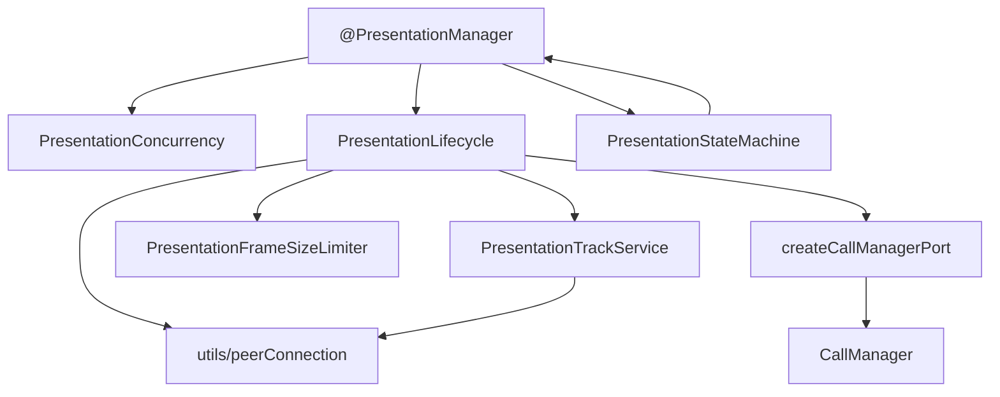

# PresentationManager (Презентации)

`PresentationManager` — тонкий фасад над оркестрацией презентации, WebRTC-слоем и `PresentationStateMachine`. Единый source of truth для состояния и активного трека — state machine; фасад делегирует start/stop/update в `PresentationLifecycle` и управляет конкурентностью через `PresentationConcurrency`.

## Назначение

- Запуск, остановка и обновление screen-sharing потока.
- Интеграция с активной RTC-сессией звонка через порт `TPresentationSessionPort`.
- Синхронизация жизненного цикла презентации с `CallManager` (renegotiate, завершение звонка).
- Публикация событий `presentation:*` в `SipConnector`.

## Ключевые возможности

- Запуск и остановка презентаций
- Обновление потока без полного stop/start (`updatePresentation`)
- Управление битрейтом презентации (`maxBitrate` в конструкторе)
- Ограничение разрешения через `maxResolution` и предел кадра H.264-энкодера, в том числе при смене размера трека во время демонстрации (`PresentationFrameSizeLimiter`)
- Обработка дублированных вызовов (`repeatedCallsAsync`)
- Поддержка P2P и MCU режимов
- Валидация переходов состояний через `PresentationStateMachine`
- Типизированные ошибки WebRTC-слоя (`PresentationReinviteError`, `PresentationTrackError`)

## Структура модуля

```shell
PresentationManager/
├── @PresentationManager.ts          # публичный фасад
├── orchestration/
│   ├── PresentationLifecycle.ts     # start / stop / update flow
│   ├── PresentationConcurrency.ts   # repeatedCalls, pending start/stop
│   ├── createCallManagerPort.ts     # TPresentationSessionPort, адаптер CallManager
│   └── index.ts
├── PresentationTrackService.ts      # registry senders, add/replace/stop track
├── PresentationFrameSizeLimiter.ts  # лимиты кадра для sendEncodings и пересчёт при смене размера
├── PresentationStateMachine/        # XState, context.videoTrack + lastError
├── errors.ts                        # PresentationReinviteError, PresentationTrackError
├── events.ts                        # TypedEvents: start/started/updating/updated/end/ended/failed
└── index.ts                         # публичные экспорты
```

WebRTC-стратегии (`addTransceiver`, `replaceTrack`, `recvOnly`, `applyContentHint`, `setPresentationMaxBitrate`) вынесены в общий модуль [`src/utils/peerConnection`](../../../../src/utils/peerConnection/). `PresentationTrackService` использует их как тонкую обёртку с регистрацией presentation senders.

## Слои и поток данных



| Слой                           | Ответственность                                                                   |
| ------------------------------ | --------------------------------------------------------------------------------- |
| `@PresentationManager`         | Публичный API, guards, делегирование в lifecycle/concurrency                      |
| `PresentationConcurrency`      | `repeatedCallsAsync`, `AbortSignal` старта, pending start/stop, cancel            |
| `PresentationLifecycle`        | Последовательность start/stop/update, события, renegotiate                        |
| `createCallManagerPort`        | Изоляция от `CallManager`: connection, session, renegotiate, onCallEnded          |
| `PresentationTrackService`     | Выбор стратегии add/replace, registry senders, stop                               |
| `PresentationFrameSizeLimiter` | `sendEncodings` по `maxResolution` и пределу энкодера, пересчёт при смене размера |
| `PresentationStateMachine`     | Состояние + `context.videoTrack` + `context.lastError`                            |

## Основные методы

| Метод                                        | Назначение                                                 |
| -------------------------------------------- | ---------------------------------------------------------- |
| `startPresentation()` / `stopPresentation()` | Запуск и завершение демонстрации экрана.                   |
| `updatePresentation()`                       | Смена текущего presentation-потока без полного stop/start. |
| `cancelSendPresentationWithRepeatedCalls()`  | Отмена повторных попыток отправки презентации.             |
| `hasCanceledStartPresentationError()`        | Проверка, что ошибка старта связана с отменой операции.    |

`startPresentation` поддерживает `isNeedReinvite` (по умолчанию `true`). `updatePresentation` всегда выполняется без renegotiate.

`beforeStartPresentation` получает `AbortSignal` старта. `stopPresentation()` и завершение звонка отменяют старт: `SipConnector` после проверки сигнализации INFO уже не отправляет, а `PresentationLifecycle` после `beforeStartPresentation` трек не добавляет. Промис старта отклоняется ошибкой отмены (`hasCanceledStartPresentationError()`), событий `start`/`failed` нет. Пока попытка запуска ожидает ответа, повторный старт отклоняется. Если сервер подтвердил INFO до отмены, остановка отзывает его даже без локального трека.

`stopPresentation()` сначала останавливает трек локально (`end` → `ended`, `active → stopping → idle`), затем вызывает `beforeStopPresentation` (INFO серверу): трек не идёт, пока сервер отвечает. Ошибка уведомления отклоняет промис остановки. Событие `failed` приходит только для той же демонстрации. Если за время ожидания началась новая, она продолжает работать.

Renegotiate презентации всегда идёт в MCU-сессию (`CallManager.renegotiateMcuSession`), независимо от роли: трек презентации добавляется в MCU-соединение. Общий `CallManager.renegotiate` для роли `spectator` пересогласует `RecvSession` и для презентации не подходит — сервер присылает `PARTICIPANT` только после ответа на `LETMESTARTPRESENTATION`, и к моменту renegotiate роль ещё `spectator`.

Если в звонке уже идёт другое согласование (например, INVITE от сервера), JsSIP (`@krivega/jssip` с 8.0.2) сам дожидается его завершения — до 5 с — и затем отправляет reINVITE. Если renegotiate вернул `false` (звонок так и не освободился или завершился) или reINVITE завершился ошибкой, старт завершается `PresentationReinviteError`, трек останавливается.

## Доступ к состоянию (breaking change)

Публичные поля `promisePendingStartPresentation`, `promisePendingStopPresentation`, `videoTrackPresentationCurrent` **удалены**.

| Было                                                                 | Стало                                                                    |
| -------------------------------------------------------------------- | ------------------------------------------------------------------------ |
| `videoTrackPresentationCurrent`                                      | `presentationManager.stateMachine.activeVideoTrack`                      |
| `promisePendingStartPresentation` / `promisePendingStopPresentation` | `presentationManager.isPendingPresentation`                              |
| —                                                                    | `presentationManager.stateMachine.pendingVideoTrack` (во время STARTING) |
| —                                                                    | `presentationManager.stateMachine.lastError` (в `failed`)                |

Геттеры `isPendingPresentation` и `isPresentationInProcess` сохранены и делегируют в state machine + concurrency.

При завершении звонка (`ended` / `failed` на `CallManager`) фасад вызывает `reset()`: отмена repeated calls, очистка pending, сброс track registry и state machine.

## События

Внутренние события `PresentationManager` проксируются в `SipConnector` с префиксом `presentation:`.

| Внутреннее | Публичное (`SipConnector`) | Когда                     |
| ---------- | -------------------------- | ------------------------- |
| `start`    | `presentation:start`       | Начало запуска            |
| `started`  | `presentation:started`     | Успешный запуск           |
| `updating` | `presentation:updating`    | Начало обновления трека   |
| `updated`  | `presentation:updated`     | Успешное обновление трека |
| `end`      | `presentation:end`         | Начало остановки          |
| `ended`    | `presentation:ended`       | Успешная остановка        |
| `failed`   | `presentation:failed`      | Ошибка start/stop/update  |

Полное API-описание: [presentation-events.md](../../../api/presentation-events.md).

## Ошибки

| Класс                       | Когда возникает                                    |
| --------------------------- | -------------------------------------------------- |
| `PresentationReinviteError` | Ошибка renegotiate после attach трека (start flow) |
| `PresentationTrackError`    | Ошибка add/replace трека в peer connection         |

Оба класса экспортируются из `sip-connector` и содержат исходную причину в поле `cause`.

## Внутренние компоненты

| Компонент                      | Роль                                                             |
| ------------------------------ | ---------------------------------------------------------------- |
| `PresentationStateMachine`     | Состояние + `context.videoTrack` + `context.lastError`           |
| `PresentationTrackService`     | WebRTC add/replace/stop с атомарной регистрацией senders         |
| `PresentationLifecycle`        | Бизнес-последовательность start/stop/update, нормализация ошибок |
| `PresentationConcurrency`      | `repeatedCallsAsync`, pending start/stop, cancel/reset           |
| `createCallManagerPort`        | Порт к `CallManager` без прямой зависимости lifecycle от его API |
| `PresentationFrameSizeLimiter` | Лимиты кадра демонстрации и сверка scale раз в секунду           |
| `@/tools/resolveSendEncodings` | Общая утилита ограничения `sendEncodings` по `maxResolution`     |

`maxResolution` для презентации передаёт `SipConnector` из `connectionConfiguration.maxAvailableResolution`
при `startPresentation()` и `updatePresentation()`.

Кадр демонстрации ограничивается также пределом H.264-энкодера: не больше 36 864 макроблоков 16×16
(`calcScaleByEncoderFrameLimit`). `resolvePresentationSendEncodings` из `PresentationFrameSizeLimiter.ts`
передаёт его в `resolveSendEncodings` как `minScaleResolutionDownBy`, поэтому действует более строгий
из двух лимитов. После успешного start/update, если демонстрация активна, `PresentationLifecycle`
включает сверку sender: сразу и затем раз в секунду лимитер считает нужный `scaleResolutionDownBy`
по текущему размеру `sender.track` и записывает его, если он отличается от текущего (`maxBitrate` не
трогает, текущий `degradationPreference` сохраняет). Ошибка `setParameters` только логируется, а запись
повторяет следующая сверка; так же возвращается scale, перезаписанный извне. Сверка снимается перед
заменой трека в `updatePresentation`, при остановке демонстрации и при завершении звонка.

Балансировщик основного видео (`VideoSendingBalancer`) не трогает sender, пока на нём трек идущей
демонстрации: `SipConnector` передаёт ему `isExcludedSender` — `PresentationManager.isPresentationSender()`.
Проверка верна только в состояниях `starting`, `active` и `stopping`. Sender исключается, если его трек —
`stateMachine.activeVideoTrack` (это покрывает старт до регистрации sender) или sender есть в реестре
`PresentationTrackService` (это покрывает `updatePresentation`, пока на sender ещё прежний трек
демонстрации). После остановки, сбоя или конца звонка тот же sender, например с камерой, балансируется как
обычно. Без камеры первый video sender с треком — демонстрация, и без этого исключения балансировщик
перезаписал бы её `scaleResolutionDownBy` и `maxBitrate`.

## Ограничения и риски

- Рост кадра во время демонстрации (развернули захватываемое окно, сменили разрешение экрана): если
  новый кадр больше предела энкодера, кадры не кодируются до следующей сверки, и демонстрация замирает не
  дольше чем на 1 с. Затем scale пересчитывается, и показ восстанавливается сам. Старт не затронут: первый
  кадр уже уходит в пределе.
- `updatePresentation()`: от `replaceTrack` до записи новых `sendEncodings` в том же вызове новый трек
  кодируется с прежним `scaleResolutionDownBy`. Если новый кадр больше предела, энкодер на эти доли
  секунды отказывает и восстанавливается после записи.
- `maxResolution` фиксируется при `startPresentation()` и `updatePresentation()`: если
  `maxAvailableResolution` сменится во время демонстрации, сверка до следующего start/update применяет
  прежний. Предел энкодера действует всегда, поэтому демонстрация не пропадает — не совпадает только
  разрешение.
- Сбой `updatePresentation()` при замене трека или записи параметров: сверка уже снята и не
  возобновляется до `stopPresentation()` или нового старта. Если после этого кадр вырастет за предел,
  демонстрация замрёт до перезапуска. Отказ сервера на `beforeStartPresentation` сверку не снимает.
- В состоянии `failed` sender демонстрации не исключён из балансировки: в звонке без камеры
  `VideoSendingBalancer` может записать в него свои `scaleResolutionDownBy` и `maxBitrate` до остановки
  или нового старта демонстрации.
- Предел H.264 применяется при любом кодеке: кадр VP8 или VP9 больше 36 864 макроблоков тоже уменьшится.
  Пересмотреть, если сервер начнёт принимать для демонстрации не только H.264.
- Камера вместо демонстрации: `replaceMediaStream()` выбирает sender по виду трека — первый video sender
  с треком. Если в основном потоке нет видеотрека, а демонстрация идёт, видеотрек нового потока заменяет
  трек демонстрации в её sender, а не добавляется отдельным sender (`addMissing` не срабатывает).
  Поведение `replaceMediaStream()` старше лимитов кадра и не исправлено.

## Связанная state machine

- [PresentationStateMachine](./state-machine.md)
